<!-- Afaq Zahir · Flutter · AI · Mobile product engineer · https://afaqzahir.com -->

<a href="https://afaqzahir.com"></a>

<p align="center">
  <a href="https://calendly.com/afaqxdev"></a>
  <a href="https://afaqzahir.com"></a>
  <a href="mailto:afaqxdev@gmail.com"></a>
  <a href="https://wa.me/923319791631"></a>
  <a href="https://www.linkedin.com/in/afaqxdev"></a>
  <a href="https://x.com/AfaqxZahir"></a>
  <a href="https://www.fiverr.com/afaqzahir"></a>
  <a href="https://www.upwork.com/freelancers/~01d82d41cd69ea37f1"></a>
</p>




> **I don't take tickets. I take ownership.** Founders hire me directly — no agency, no project manager — when they need one engineer who owns the app from first call to release.

<table>
<tr>
<td width="50%" valign="top">

**🚀 Build something new**<br/>
A 30-day MVP that actually works on launch day — Flutter for iOS and Android from one codebase.

</td>
<td width="50%" valign="top">

**🩺 Fix what's broken**<br/>
Memory leaks, UI jank, architecture rot. I rescue Flutter codebases other teams gave up on.

</td>
</tr>
<tr>
<td valign="top">

**🧠 Add AI to your product**<br/>
ChatGPT, Gemini and Claude with real-time streaming — and API keys that never touch the client.

</td>
<td valign="top">

**🎨 Turn design into product**<br/>
Pixel-accurate Figma → Flutter, with motion that holds 120fps on mid-range phones.

</td>
</tr>
<tr>
<td valign="top">

**🔥 Build the backend**<br/>
Firebase and Cloud Functions that don't turn into a cost nightmare at scale.

</td>
<td valign="top">

**🤝 Take over a project**<br/>
Code audit, migration and a clear plan — then I own it like I'll maintain it myself.

</td>
</tr>
</table>




<details>
<summary><b>The 120fps standard — what "profiled, not guessed" means</b></summary>
<br/>

Every app I ship is benchmarked against a 120fps target on mid-range Android hardware:

- **Impeller** rendering enabled and tested
- **Rebuilds** measured — no widget rebuilds that don't need to happen
- **Shaders** verified — no shader compilation jank in hot paths
- **Images** decoded, cached and precached — never loaded on demand mid-scroll

</details>

<details>
<summary><b>The folder structure I enforce on every Flutter project</b></summary>
<br/>

```
lib/
├── app/          di/ (get_it) · router/ (GoRouter) · app.dart
├── core/         constants · theme · utils · extensions
├── features/
│   ├── auth/     data · domain · logic · presentation
│   ├── home/     data · domain · logic · presentation
│   └── …
├── data/         models (Freezed) · repositories · data_sources
└── main.dart
```

Every feature is a self-contained module — delete any feature folder and the app still builds.

</details>


| | App | What it does | Get it | Story |
|:-:|---|---|---|---|
| 🧭 | **TourVista** | AI travel guide | [iOS](https://apps.apple.com/us/app/tourvista/id6747093104) · [Android](https://play.google.com/store/apps/details?id=com.tourvistaapp) | [Case study →](https://afaqzahir.com/case-studies/tourvista) |
| 🖼️ | **LQDCNVS** | 4K digital art on phones, Android TV & Fire TV | [iOS](https://apps.apple.com/us/app/lqdcnvs-liquid-canvas-art/id6478953093) · [Android](https://play.google.com/store/apps/details?id=com.metasense.lqdcnvs_mobile) · [Web](https://www.liquidcanvas.art/) | [Case study →](https://afaqzahir.com/case-studies/lqdcnvs) |
| 🪺 | **Nest AI** | Privacy-first parenting companion, encrypted on-device | [iOS](https://apps.apple.com/us/app/nest-ai-parenting-companion/id6450738689) · [Android](https://play.google.com/store/apps/details?id=com.metasense.nest) | [Case study →](https://afaqzahir.com/case-studies/nest) |
| 🗣️ | **Fluently AI** | Language learning with on-device OCR | [iOS](https://apps.apple.com/us/app/fluently-ai/id6446021804) · [Android](https://play.google.com/store/apps/details?id=com.metasense.fluently) | [Case study →](https://afaqzahir.com/case-studies/fluently) |
| 💬 | **Penitans** | Consultant booking with real-time chat | [iOS](https://apps.apple.com/us/app/penitans/id6745785643) · [Android](https://play.google.com/store/apps/details?id=com.penitans.org) | [Case study →](https://afaqzahir.com/case-studies/penitans) |
| 🛎️ | **Omni Connect** | Multi-tenant service booking | [iOS](https://apps.apple.com/pk/app/omni-connects/id6444658082) · [Android](https://play.google.com/store/apps/details?id=com.omni.main) | [Case study →](https://afaqzahir.com/case-studies/omni) |
| 🌙 | **GAIA AI** | AI dream journal — multi-model LLM routing, SSE streaming, DALL·E art | [iOS](https://apps.apple.com/us/app/gaia-ai-dream-interpretor/id6450891063) | [Case study →](https://afaqzahir.com/case-studies/gaia) |
| 🔕 | **Smart Silent** | Auto-mute by schedule or location | [Android](https://play.google.com/store/apps/details?id=com.smartsilent.automute.silentscheduler) | |

<sub>Also live: [AI US Citizenship Test](https://play.google.com/store/apps/details?id=com.us.citizenship.test.naturalization.civics.prep) · [Health & Vitals Monitor](https://play.google.com/store/apps/details?id=com.vitals.bp.family.health.tracker) · [Zemen](https://play.google.com/store/apps/details?id=com.ethiopia.zemen.calendar.aqotater.ethiopian.habesha) · [Punj Surah](https://play.google.com/store/apps/details?id=com.punj.surah.yaseen.surah_yaseen) · [AI Humanizer](https://play.google.com/store/apps/details?id=com.ai.humanizer.bypass.detector.plagiarism.remover) · [HerCycle](https://play.google.com/store/apps/details?id=com.hercycle.period.menstrual.cycle.tracker.ovulation.fertility) · [ZenPeace](https://play.google.com/store/apps/details?id=com.zenpeace.pomodoro.focus.timer.mindfulstate)</sub>





**📦 Open source** — [`tag_field`](https://pub.dev/packages/tag_field) · a declarative tag-input widget for Flutter on pub.dev

**✍️ Guides on [afaqzahir.com/blog](https://afaqzahir.com/blog)**

- [How to Build a Flutter App With AI in 2026 — my Claude, ChatGPT, Stitch & Antigravity workflow](https://afaqzahir.com/blog/how-to-build-flutter-app-with-ai-2026)
- [Integrating ChatGPT, Gemini & Claude into a Flutter app — without leaking API keys](https://www.afaqzahir.com/blog/integrate-llm-models-chatgpt-gemini-flutter-mobile)
- [How Much Does a Flutter App Cost in 2026? Real price ranges by app type](https://afaqzahir.com/blog/flutter-app-development-cost)
- [Flutter vs React Native in 2026: which should a startup choose?](https://afaqzahir.com/blog/flutter-vs-react-native-for-startups)


<picture>
  <source media="(prefers-color-scheme: dark)" srcset="https://raw.githubusercontent.com/afaqxdev/afaqxdev/output/snake-dark.svg"/>
  
</picture>

<p align="center">
  <br/>
  <b>Got an app idea, or an app that's falling apart?</b><br/>
  <sub>Replies in 2–4 hours · Peshawar, Pakistan (UTC+5) · working with US / UK / EU startups</sub><br/><br/>
  <a href="https://calendly.com/afaqxdev"></a>
</p>
